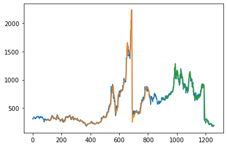
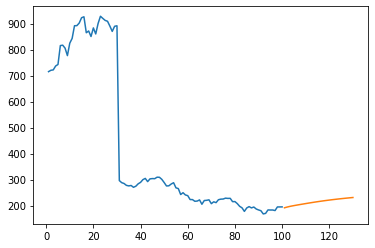

# 📈 Stock Price Forecasting with a Stacked LSTM


Forecasting daily stock closing prices with a **stacked LSTM** (Long Short-Term Memory)
neural network. The model learns from five years of Tesla prices, is checked against data
it has never seen, and then forecasts the **next 30 trading days**.

> Part of my 7th semester project on stock prediction. The follow-up project,
> **[StockPredictionWebApp](https://github.com/ayushupadhyayk/StockPredictionWebApp)**,
> turns a similar model into an interactive Streamlit web app.

## Contents

- [Results](#results)
- [Quick start](#quick-start)
- [Dataset](#dataset)
- [How it works](#how-it-works)
- [Model architecture](#model-architecture)
- [Project structure](#project-structure)
- [Known issues and limitations](#known-issues-and-limitations)
- [Tech stack](#tech-stack)

## Results

**Model fit.** Actual Tesla closing price (blue), predictions on the training data (orange)
and predictions on the unseen test data (green). The x-axis is trading days since December 2017.



**30-day forecast.** The last 100 trading days of real prices (blue), followed by the model's
forecast for the next 30 days (orange).



## Quick start

```bash
git clone https://github.com/ayushupadhyayk/StockPriceForecasting.git
cd StockPriceForecasting
pip install numpy pandas matplotlib scikit-learn tensorflow jupyter
jupyter notebook "Stack LSTM.ipynb"
```

The first cells of the notebook download fresh data from Tiingo. To use the bundled data
instead, skip them and start from:

```python
df = pd.read_csv('TSLA.csv')
```

To download new data, sign up for a free [Tiingo](https://www.tiingo.com) API key and keep
it out of the notebook, for example in an environment variable:

```python
import os
df = pdr.get_data_tiingo('TSLA', api_key=os.environ['TIINGO_API_KEY'])
```

## Dataset

Daily prices for three stocks from **4 December 2017 to 2 December 2022** (1,259 trading
days each), downloaded from the Tiingo API.

| File | Stock |
|---|---|
| `TSLA.csv` | Tesla, used by the notebook |
| `APPL.csv` | Apple (the filename has a typo for AAPL) |
| `GOOGL.csv` | Alphabet (Google) |

Each file contains `open`, `high`, `low`, `close` and `volume`, the split-adjusted
versions of each (`adjClose` and so on), dividends (`divCash`) and `splitFactor`.

## How it works

1. **Load** the daily closing prices.
2. **Scale** them to the 0–1 range with `MinMaxScaler`, which helps the network train.
3. **Split** in time order: the first **65%** for training (818 days) and the last **35%**
   for testing (441 days), so the model is always tested on later data than it learned from.
4. **Window** the series: every input is the previous **100 days** and the target is the next day.
5. **Train** the stacked LSTM for **100 epochs** (batch size 64, Adam optimiser, mean squared
   error loss). The loss drops from about 0.020 to about 0.001 on the scaled data.
6. **Evaluate** by predicting on both sets, converting back to dollars and plotting against the real prices.
7. **Forecast** recursively: predict tomorrow from the last 100 days, add that prediction to
   the window, and repeat 30 times.

## Model architecture

```
Input: 100 days × 1 feature (closing price)
        │
   LSTM (50 units, return sequences)
        │
   LSTM (50 units, return sequences)
        │
   LSTM (50 units)
        │
   Dense (1)  →  next day's price
```

| Layer | Output shape | Parameters |
|---|---|---|
| LSTM | (100, 50) | 10,400 |
| LSTM | (100, 50) | 20,200 |
| LSTM | (50) | 20,200 |
| Dense | (1) | 51 |
| **Total** | | **50,851** |

## Project structure

```
StockPriceForecasting/
├── Stack LSTM.ipynb      # Data loading, model, training, evaluation and forecast
├── TSLA.csv              # Tesla daily prices (used by the notebook)
├── APPL.csv              # Apple daily prices
├── GOOGL.csv             # Alphabet daily prices
└── images/               # Charts used in this README
```

## Known issues and limitations

- **Stock splits aren't adjusted for.** The notebook uses the raw `close` column, so Tesla's
  5-for-1 split (August 2020) and 3-for-1 split (August 2022) appear as sudden price drops,
  as the charts show. Using `adjClose` instead gives a continuous price history.
- **The RMSE figures in the notebook aren't meaningful.** Predictions are converted back to
  dollars, but the true values they're compared against are still scaled to 0–1. Convert
  both before comparing to get a real error figure.
- **Small mismatch in the forecast loop.** The model is trained on 100-day windows, but the
  forecast loop passes 99 days (`n_steps = 99`).
- **Price only.** Volume, news, earnings and market-wide factors aren't used.
- **Errors compound.** Each forecast day builds on earlier predictions, so confidence falls
  the further ahead the forecast goes.

This project is for learning purposes only and is not financial advice.

## Tech stack

| Area | Tools |
|---|---|
| Language | Python |
| Environment | Jupyter Notebook |
| Data | pandas, NumPy, pandas-datareader (Tiingo API) |
| Preprocessing | scikit-learn (`MinMaxScaler`) |
| Model | TensorFlow / Keras (`Sequential`, `LSTM`, `Dense`) |
| Visualisation | Matplotlib |
